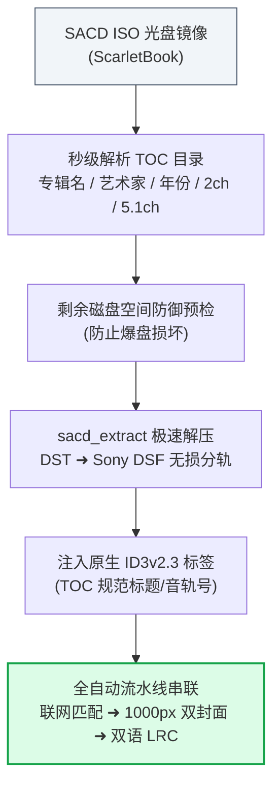

# 🎵 MusicMetadata 音乐元数据治理套件

[](https://www.python.org/) [](https://github.com/waves-dylan/MusicMetadata) [](https://github.com/waves-dylan/MusicMetadata/blob/main/LICENSE) [](https://github.com/waves-dylan/MusicMetadata) [](https://github.com/waves-dylan/MusicMetadata/releases)

专为**本地高保真数字音乐收藏者与强迫症患者**打造的桌面级曲库治理利器。

集成 **三大多媒体播放器（foobar2000 / MusicBee / Roon）深度协同**、**双封面（Type 3 专辑封面 + Type 8 艺术家写真）规范化治理与合辑安全隔离**、**首版大碟智能加权挑选向导**、**SACD ISO 绿色免装分轨与全自动洗标流水线**、**多源双语歌词校对与毫秒级时间轴微调**、**华语简繁文本智能归一化与 J-Pop 防误伤守卫**、**脏标签安全净化** 与 **DFF ➜ DSF 原生流式极速转封装** 于一体的桌面管理套件（GUI + CLI）。

---

## 目录

- [✨ 功能特性](#-功能特性)
- [📦 支持的音频格式](#-支持的音频格式)
- [⚡ 30 秒极速上手](#-30-秒极速上手)
- [🧭 实战场景指南](#-实战场景指南)
  - [场景 1：视觉强迫症——专辑封面与高清写真治理](#场景-1视觉强迫症专辑封面与高清写真治理)
  - [场景 2：发烧友极简——SACD ISO 一站式提取与全自动洗标](#场景-2发烧友极简sacd-iso-一站式提取与全自动洗标)
  - [场景 3：双语歌词匹配与毫秒级时间轴微调](#场景-3双语歌词匹配与毫秒级时间轴微调)
  - [场景 4：三大播放器（foobar2000 / MusicBee / Roon）深度联动秘籍](#场景-4三大播放器foobar2000--musicbee--roon深度联动秘籍)
  - [场景 5：脏标签深度净化与音频格式转换](#场景-5脏标签深度净化与音频格式转换)
  - [场景 6：华语流行简繁归一化与 J-Pop 防误伤](#场景-6华语流行简繁归一化与-j-pop-防误伤)
- [💡 核心避坑指南与最佳实践](#-核心避坑指南与最佳实践)
  - [经验 1：特定音源的选择经验与实操心得](#经验-1特定音源的选择经验与实操心得)
  - [经验 2：SACD ISO 分轨的实战避坑与技巧](#经验-2sacd-iso-分轨的实战避坑与技巧)
  - [经验 3：群星/合辑 (Various Artists) 目录的绝对禁忌](#经验-3群星合辑-various-artists-目录的绝对禁忌)
  - [经验 4：发烧只读保护（DFF 格式）的底线原则](#经验-4发烧只读保护dff-格式的底线原则)
  - [经验 5：繁简转换的消歧机制与外挂歌词无损处理](#经验-5繁简转换的消歧机制与外挂歌词无损处理)
- [🖱️ 界面效率秘籍与右键百宝箱](#️-界面效率秘籍与右键百宝箱)
- [💻 极客与命令行速查 (CLI Reference)](#-极客与命令行速查-cli-reference)
- [🛠️ 开发者专区与技术内幕 (Developer Zone)](#️-开发者专区与技术内幕-developer-zone)
- [📄 许可证](#-许可证)

---

## ✨ 功能特性

- 🔍 **多音源自动搜索匹配歌曲**：覆盖网易云、QQ音乐、Apple/iTunes、MusicBrainz、TheAudioDB、Fanart.tv、Discogs、酷狗、酷我、咪咕、百度、Deezer、YouTube Music、LRCLIB、Spotify 等 14+ 平台。
- 🖼️ **嵌入专辑正面封面 (Type 3)**：1000px 优质 JPEG 规范化，首版大碟智能加权算法，多专辑流水线向导极速挑选。
- 👤 **嵌入艺术家高清写真 (Type 8)**：多源并发探测艺人头像/写真，支持一键无缝同步至 MusicBee 中央写真库 (`Artist Pictures/<Artist>.jpg`)。
- 📝 **嵌入与外置双语歌词**：支持原文+翻译逐行合并，配备可视化向导与毫秒级时间轴平移微调，支持根据歌词版本反哺母碟封面。
- 🌐 **华语简繁文本智能归一化**：内置 OpenCC 权威 3200+ 字符映射与词组上下文消歧（如头发/发生、天后/后来、复杂/恢复），自带音乐专有名词白名单（伍佰/Beyond/草蜢/陶喆）与 J-Pop 假名防误伤守卫；配备实时可视化 Diff 比对弹窗与 LRC 同步歌词时间轴无损保护。
- 💿 **SACD ISO 绿色免装极速分轨**：免配外部工具，秒级解析 ScarletBook TOC，目标磁盘空间防御预检，无损提取 DST ➜ Sony DSF 并全自动串联洗标。
- 🎧 **三大多媒体播放器深度协同**：foobar2000 缓存对比与热重载、MusicBee 监控与写真库联动、Roon 专属标签支持与文件监听触发。
- 🏷️ **写入与补全规范元数据**：标题、艺术家、专辑、年份、音轨号、碟号、作曲、作词、编曲、流派等全面补齐。
- ✏️ **手动批量设置自定义字段**：支持任意自定义标签与批量覆写，默认安全保留网易云 `163 key`。
- 🗑️ **选择性批量安全清标**：按需分类剔除垃圾广告注释、损坏封面或多余字段，自带防误删保护与预演机制。
- 📊 **曲库状态多维排查呈现**：自动核对标签/封面异常，支持 Ctrl+F、多词防抖搜索与自适应右键动态筛选。
- 🔄 **音频格式转换与无损转封装**：FFmpeg 格式转换与元数据补偿；DFF ➜ DSF 纯 Python 零依赖流式极速转封装（秒级完成，零音质损耗）。
- ⚡ **零拷贝就地写入与并发加速**：In-Situ 原生就地写入性能提升 5~20 倍，HTTP 长连接池复用与多线程并发调度。
- 📁 **外置视觉资产规范与安全隔离**：单专辑规范生成 `cover.jpg` / `artist.jpg`，群星合辑自动拒绝外置写真并安全备份为 `.bak`。
- 🛡️ **发烧格式只读守护**：`.dff` 纯物理只读保护，杜绝非标准内嵌导致的数播设备爆音或损坏。

---

## 📦 支持的音频格式

| 格式 | 读取标签 | 写入标签 | 歌词处理 (LRC) | 封面与写真 (Type 3 / 8) | 备注 |
| :--- | :---: | :---: | :---: | :---: | :--- |
| **FLAC** | ✅ Vorbis | ✅ 原生就地更新 | ✅ `LYRICS` 内嵌 | ✅ Type 3 封面 + Type 8 写真 | 无损发烧首选，就地高速写入 |
| **MP3** | ✅ ID3v2 | ✅ ID3v2.3/v2.4 | ✅ `USLT` 内嵌 | ✅ APIC 封面 + APIC 写真 | 自动适配旧版播放器编码 |
| **M4A / ALAC** | ✅ MP4 Atom | ✅ MP4 原子标签 | ✅ `©lyr` 内嵌 | ✅ `covr` 内嵌 / 📁 外部写真 | Apple 生态与便携设备友好 |
| **DSF (DSD)** | ✅ ID3v2 | ✅ ID3v2 就地写入 | ✅ `USLT` 内嵌 | ✅ Type 3 封面 + Type 8 写真 | 索尼高解析 DSD 规范格式 |
| **DFF (DSD)** | ✅ DSDIFF 识别 | ❌ **物理只读保护** | 📁 自动外挂 `.lrc` | 📁 规范 `cover` / `artist.jpg` | 支持一键流式转封装为 `.dsf` |
| **SACD ISO** | ✅ TOC 镜像解析 | ❌ **光盘镜像只读** | 💿 分轨时自动抓取 | 💿 分轨时自动注入双封面 | 内置免安装 `sacd_extract` 工具 |
| **WAV** | ✅ RIFF / ID3 | ✅ ID3 Chunk | 📁 自动外挂 `.lrc` | ✅ ID3 内嵌 / 📁 外部双规 | 优先生成外挂 LRC 保障车载兼容 |
| **AIFF** | ✅ ID3 Chunk | ✅ ID3v2 写入 | ✅ `USLT` 内嵌 | ✅ Type 3 封面 + Type 8 写真 | Apple 原生无损发烧格式 |
| **OGG / Opus** | ✅ Vorbis | ✅ 原生写入 | ✅ Vorbis Comment | ✅ 规范双封面内嵌 | 现代高压缩比开源格式 |
| **APE / WV** | ✅ APEv2 | ✅ APEv2 写入 | 📁 自动外挂 `.lrc` | ✅ APE 封面 / 📁 外部写真 | 兼容经典无损音频容器 |
| **TAK / MPC / TTA**| ✅ APEv2 / ID3 | ✅ 容器标签支持 | 📁 自动外挂 `.lrc` | ✅ 规范内嵌 / 📁 外部写真 | 小众经典格式无缝读取 |

> [!NOTE]
> **发烧格式与容器特性说明**：
> - **DFF 格式保护与无损转封装**：`.dff` 原生缺乏标准的 ID3 规范，强行内嵌会导致大量数播硬件（欧珀、艾索洛、索尼金砖、车机）爆音或识别为损坏。软件实行只读物理保护，并提供**纯 Python 零依赖流式极速转封装为 DSF**（无需重编码，秒级完成，音质零损耗），转换后即可完美内嵌封面与完整标签。
> - **WAV / APE 歌词兼容策略**：WAV 与 APE 容器受多数移动端和车载播放器限制，往往不支持内嵌歌词流读取。系统采用 `auto` 智能策略：自动优先生成同名外挂 `.lrc`，确保 100% 播放器兼容性。
> - **SACD ISO 绿色免装工具链**：内置免安装的 `tools/sacd_extract.exe`，免去发烧友手动寻找配置外部命令行工具的痛苦；分轨解压前自带目标磁盘剩余空间预检，解压后全自动串联注入 TOC 标签、匹配双封面与双语歌词。

---

## ⚡ 30 秒极速上手

无需安装 Python 或任何复杂环境，双击 [MusicMetadata.exe](MusicMetadata.exe) 即可启动。


1. **自动识别曲库**：
   - 启动软件后，系统会自动侦测当前运行或安装的 **foobar2000**、**MusicBee**、**Roon** 并载入其监控的音乐目录；未检测到播放器时自动载入系统 `~/Music`。
2. **扫描与排查**：
   - 点击 **「扫描媒体库」**，表格以清晰颜色标识歌曲状态（`正常`、`缺少封面`、`未同步` 等）。勾选右上角 **「只显示待处理曲目」** 可专注排查问题音轨。
3. **一键执行**：
   - 在左下角按需勾选修复项（如封面、年份、流派、音轨号、歌词），点击 **「一键修复已选项目」**，数秒内完成批量治理。

> [!TIP]
> **安全预演 (Dry-Run)**：如果您担心误修改珍藏曲目，可在界面勾选预演或在命令行中使用 `--dry-run` 选项，软件将完整输出所有预计修改项，但**绝不写入磁盘一字节**。

---

## 🧭 实战场景指南

### 场景 1：视觉强迫症——专辑封面与高清写真治理

许多同类工具最大的痛点在于**盲目抓取**——搜索一首老歌，默认直接下载了现代拼盘精选辑的海报当做封面；或者把多歌手合辑里随手放的某张歌手写真错误内嵌进了整张专辑，导致播放器封面错乱。

MusicMetadata 打造了业内极其严苛的视觉双封面体系：


#### 1. 怎么选出最完美的正统大碟封面？
- **使用「挑选封面...」向导 (`CoverPickerDialog`)**：
  - 在曲目列表右键单击或点击工具栏 **「挑选封面...」**。
  - **三级梯队智能检索架构**：
    1. 第一优先：搜索 `专辑名 + 艺术家`（精准命中原始录音室大碟，彻底避开单曲翻唱或现场版）；
    2. 第二优先：无专辑名时搜索 `歌名 + 艺术家`（反查母碟大碟）；
    3. 第三优先：以 `歌名` 兜底保底。
  - **首版大碟打分算法**：系统自动给 70~80 年代首版、黑胶 LP、复黑王 BTB 大幅加分，给“精选集 / 选辑 / Live 演唱会”强力扣分，最具收藏价值的经典原盘封面排在首位。
- **流水线批处理模式（极速过审）**：
  - 当你在列表中勾选了多首不同专辑的歌曲时呼出向导，自动进入**多专辑流水线向导模式**；
  - 浏览并确认当前专辑封面后，点击右下角 **「应用并下一个 ▶」**，软件自动完成落盘、更新标签并无缝滑动到下一张专辑；如果遇到无需更改的专辑，点击 **「跳过此专辑 ⏩」**；
  - 顶部下拉框可随时自由切换与回看任意专辑进度（显示 `[待挑选]` / `[已保存 ✓]`）。

#### 2. 一键补全艺术家高清写真 (Artist Art)
- 在主界面勾选 **「获取艺术家图」**，系统将从 TheAudioDB、Fanart.tv、网易云等高保真视觉库检索艺人正方形写真；
- **双封面共存**：内嵌为标准的 ID3 Picture Type = 8 帧，与正面封面 (Type = 3) 和平共处，单曲体积增量仅 50~200KB；
- **封面向导伴随写真胶囊**：在 `CoverPickerDialog` 挑选封面时，左侧会自动伴随展示该专辑艺人的候选写真；当封面向导结束时，系统还会自动盘点尚未配置写真的艺人，一键询问是否拉起写真补漏向导。

---

### 场景 2：发烧友极简——SACD ISO 一站式提取与全自动洗标

收藏 DSD/SACD 的发烧友通常有一大堆数 GB 级的 `.iso` 镜像文件。传统做法需要到处找老旧的命令行工具、手工敲命令解压，解压出来的 DSF 音轨没有任何标签、没有封面、更没有歌词。

MusicMetadata 将整个发烧工作流压缩为**一键全自动**：



1. **零安装绿色集成**：内置预调优的绿色单文件 `tools/sacd_extract.exe`，开箱即用。
2. **TOC 秒级可视化查看**：点击界面 **「⚡ SACD提取...」** 并载入 ISO 文件，瞬间解析出光盘目录结构，支持选择提取 **2.0 立体声 (2ch)** 或 **5.1 多声道 (mch)** 区域。
3. **空间安全防御拦截**：解压前精确计算目标驱动器剩余空间，若空间不足立即拦截并警示，绝不发生解压到一半磁盘溢出爆盘。
4. **无缝串联元数据修复**：勾选“提取后自动串联元数据修复”，提取出来的 DSF 音轨不仅拥有原汁原味的 TOC 标题，还会自动联网匹配发行日期、作曲家、流派，内嵌 1000px 封面与歌手写真，并下载双语同步歌词！

---

### 场景 3：双语歌词匹配与毫秒级时间轴微调

无论是车机、手机还是桌面播放器，歌词体验至关重要。

1. **跨音源双语对照合并**：
   - 支持从网易云、QQ 音乐、酷狗、LRCLIB 多平台抓取歌词；
   - 自动检测并合并“原文 + 翻译”双语时间轴，提供 `auto`（WAV/APE 自动外挂 `.lrc`，其余容器内嵌）、`embed`、`lrc`、`both` 四种写入模式。外挂 `.lrc` 时自动补全标准 `[ti:]` / `[ar:]` / `[al:]` 头信息。
2. **歌词挑选与校对向导 (`LyricPickerDialog`)**：
   - 当遇到同名异曲、翻唱版本或伴奏时，右键音轨点击 **「挑选/更换歌词...」**；
   - 弹窗多源并发列出候选版本（明确标示平台、匹配分、时长差、是否包含翻译）；
   - **毫秒级时间轴实时平移**：若歌词唱快了或唱慢了，在弹窗下方点击 `+0.5s`、`-0.5s` 或手动输入偏移量，实时刷新时间轴并一键写盘。
3. **歌词反哺专辑封面**：
   - 当单曲本身缺少专辑信息时，通过挑选歌词找到正版母碟音轨后，可一键将该候选版本的高清封面与正式专辑名**反向反哺回写**给本地曲目与同目录 `cover.jpg`。

---

### 场景 4：三大播放器（foobar2000 / MusicBee / Roon）深度联动秘籍

软件绝非孤立的本地文件修改器，而是与您日常主力播放器深度咬合的“后勤总管”。

| 播放器 | 联动机制与独家特色 | 实战体验与操作建议 |
| :--- | :--- | :--- |
| **foobar2000** | **metadb 差异对比与即时热重载**<br>自动解析 `library-v2.0\folders` 配置与 `metadb.sqlite` 二进制文件，修改后通过推进 mtime 并唤醒 `/context_command` 命令触发重新加载。 | 修改完歌曲无需关闭或重启 foobar2000，也不用右键全选强制刷新，播放器界面上的标签和封面瞬间自动刷新变动。 |
| **MusicBee** | **中央艺术家写真库联动**<br>解析 `MusicBee3Settings.ini` 监控目录，针对 FAT32/exFAT 修改时间精度推进；支持一键将写真推入 MusicBee 中央写真库 (`Artist Pictures/<Artist>.jpg`)。 | **彻底拯救 MusicBee 的歌手头像缺失**！在向导或修复中勾选同步至 MusicBee，软件会自动将规范化写真保存到对应位置，MusicBee 界面瞬间告别灰色小人剪影。 |
| **Roon** | **文件监听触发与 MusicBrainz / Roon 专属标签**<br>自动定位 Roon/RoonServer 环境，通过时间戳推进触发 Roon Core 重新分析；全面读写 `musicbrainz_albumid`、`musicbrainz_trackid` 及 Roon 专属的 `roonalbumtag`、`roontracktag` 等标签。 | 与 Roon 云端庞大的音乐图谱无缝对接，让自建曲库与 Roon 官方精选推荐完美融合，杜绝元数据识别成“Unknown Album”。 |

---

### 场景 5：脏标签深度净化与音频格式转换

1. **批量选择性安全清标 (`--delete` / 「删除部分元数据...」)**：
   - 针对某些网站下载音频中附带的垃圾注释、推广链接、错误艺术家或损坏封面；
   - 支持分类勾选删除（封面、写真、注释、歌词、作曲、音轨号等）；
   - **核心安全红线**：默认严密保护网易云 `163 key(Don't modify):...` 标签，避免破坏网易云音乐客户端与云盘的指纹映射。
2. **DFF ➜ DSF 纯原生流式极速转封装**：
   - `.dff` (DSDIFF) 是发烧友常用的纯 DSD 格式，但它原生**不支持嵌入任何 ID3v2 标签与封面**，导致播放器无法显示信息；
   - 传统转换需要外部巨型软件重新编码，而 MusicMetadata 内置**纯 Python 实现的流式转封装引擎**，直接解构 DSD 数据帧重新封包为 `.dsf` 容器，**耗时只需数秒、零音质损耗、零外部依赖**，瞬间让音频具备内嵌封面与完整标签的能力。
3. **基于 FFmpeg 的格式转换**：
   - 支持转码为 FLAC、MP3、M4A、OGG、Opus、WAV、AIFF；转换完成后自动由 `tag_io` 执行封面、标签与外置歌词文件的无损补偿与完整性校验。

---

### 场景 6：华语流行简繁归一化与 J-Pop 防误伤

本地华语音乐库的一大常见痛点是繁简混杂：同一位歌手（如“鄧麗君”与“邓丽君”、“張學友”与“张学友”）在播放器中被硬生生拆分为两个不同条目，导致专辑和歌单割裂。

MusicMetadata 内置了专业级华语音乐简繁智能处理引擎（`core.zh_norm` + `ZhConvertDialog`）：


1. **上下文消歧与白名单保护**：
   - 绝非机械的单字替换，针对常见的“一简对多繁”进行深层词组上下文消歧（如“头发乱了”准确转为“頭髮亂了”，而非“頭發亂了”）；
   - 白名单锁定华语乐坛特例（如摇滚歌手“伍佰”永不转为“伍百”）；
2. **J-Pop / 日文汉字防误伤守卫**：
   - 自动检测日文假名（平假名/片假名）或知名日文音乐人（坂本龍一、久石譲、米津玄師等），坚决防止日文常用汉字被强行篡改为简体汉字；
3. **LRC 同步歌词结构化保护**：
   - 精准剥离 `[mm:ss.xx]` 时间轴标记与 `[ti:]` / `[ar:]` 头部标签，仅对纯歌词正文文本进行转换，毫秒级时间戳完好无损。
4. **实时 Diff 差异比对**：
   - 弹窗直观显示变动项对照表（例如 `鄧麗君 -> 邓丽君`），变动处一目了然，支持勾选特定字段（如仅转换歌手和专辑，保留标题）。

---

## 💡 核心避坑指南与最佳实践

### 经验 1：特定音源的选择经验与实操心得

在主界面的 **「音源偏好」** 下拉框中，支持选择预设或进入「数据源...」高级微调。结合海量实测数据，我们总结出以下最佳搭配法则：

```
                    ┌── 华语流行 / 经典老歌 / 双语歌词 ── QQ音乐 + 网易云 (优先)
                    ├── 欧美流行 / 官方母带高清大碟 ── Apple/iTunes + Deezer
在线音源搭配罗盘 ──┼── 艺人高清正方形写真 / 艺术图 ── TheAudioDB + Fanart.tv
                    ├── 古典交响 / 原声带 / 严谨分卷 ── MusicBrainz
                    ├── 黑胶抓轨 / 实体版次 / 细分流派 ── Discogs
                    └── 小众英文 / 开源纯净同步词 ── LRCLIB + YouTube Music
```

- **国内经典老歌与流行金曲** ➜ 推荐 **`网易云`** 与 **`QQ音乐`**：
  - 双语歌词与中文音轨号覆盖率极高；
  - 务必配合软件内置的“首版大碟加权算法”，自动剔除《XX演唱会Live版》和《世纪经典合辑》对封面的污染。
- **正统录音室封面与官方年份** ➜ 推荐 **`Apple/iTunes`**：
  - Apple Music 提供的正方形封面分辨率高、无任何平台水印、无拼盘杂音，发行年份最为严谨（原发日期而非重印日期）。
- **实体版次、黑胶首版与内页演职员名单** ➜ 推荐 **`Discogs`**：
  - 全球最庞大的实体唱片数据库，拥有无可匹敌的版次（Pressing）、唱片编号（Catalog No.）与精细风格（Style）数据；
  - 完整解析内页 Liner Notes 演职员（作曲、作词、编曲、乐手阵容）与黑胶分面（Side A/B）音轨号；支持在「数据源设置」中配置 Personal Access Token 开启。
- **艺术家高清写真与头像** ➜ 强烈推荐 **`TheAudioDB`** 与 **`Fanart.tv`**：
  - 软件内置已配置好的公共 API Key，开箱即用；
  - 拥有全球社区评选的高分正方形艺人写真，特别适合作为 Picture Type = 8 或 MusicBee 中央库头像。
- **古典乐、严谨盒装大碟与 Roon 用户** ➜ 推荐 **`MusicBrainz`**：
  - 拥有极为严苛的多碟编号、发行版别与 MBID 关联体系。
- **完全免登录的开源歌词** ➜ 推荐 **`LRCLIB`**：
  - 极速轻量，专门针对开源同步歌词库直连，无任何版权反爬干扰。

---

### 经验 2：SACD ISO 分轨的实战避坑与技巧

> [!WARNING]
> **发烧友必须注意的 2 个细节**：
> 1. **立体声 (2ch) 与多声道 (mch) 存放路径**：如果一张 SACD ISO 同时包含 2ch 和 5.1ch 轨道，强烈建议解压到不同子目录（例如 `Album_2ch` 与 `Album_Surround`），避免两者的 DSF 文件名相同导致覆盖。
> 2. **预留充分的磁盘容量**：DST 高压缩解压为未压缩的 DSF 文件后，体积通常会膨胀 2~3 倍。一整张 SACD 解压需要 2GB~4.5GB 连续空间。**请时刻留意弹窗中的磁盘空间预检提示**。

---

### 经验 3：群星/合辑 (Various Artists) 目录的绝对禁忌

> [!IMPORTANT]
> **为什么多歌手目录绝对不能写外置 `artist.jpg`？**
> 很多新手喜欢把几十首不同歌手的单曲堆在一个文件夹里。如果给这个目录放置了一张 `artist.jpg`（比如王菲的照片），foobar2000 或 MusicBee 会把这个目录下的张学友、周杰伦、陈奕迅通通显示成王菲！
> 
> **软件的防御机制**：
> - 当系统检测到当前目录包含多个不同艺术家时，**坚决拒绝落地外置 `artist.jpg`**；
> - 若发现该目录下已经存在历史残留的 `artist.jpg`，系统会自动将其安全重命名为 `disabled-artist.jpg.bak` 撤回备份，彻底阻断错误头像污染。

---

### 经验 4：发烧只读保护（DFF 格式）的底线原则

> [!CAUTION]
> **切勿对 `.dff` 音频强行内嵌写标！**
> 部分小众工具尝试用非标准的 ID3v2 结构强行追加在 `.dff` 文件头尾，这会导致许多高端硬件数播（如欧珀、艾索洛、索尼金砖、车载数播）直接将文件识别为“已损坏”或在播放开始/结束时发出刺耳的直流爆音。
> 
> **MusicMetadata 的原则**：
> - 对 `.dff` 实行只读物理保护，只在同目录下生成规范的 `cover.jpg` 和外挂 `.lrc`；
> - 如果希望拥有内嵌封面的现代化体验，请使用本工具右键将其无损转换为 `.dsf`。

---

### 经验 5：繁简转换的消歧机制与外挂歌词无损处理

> [!TIP]
> **繁简转换实战技巧**：
> 1. **先预演比对，后批量应用**：在呼出的「华语简繁转换」对话框中，系统会先实时计算变动字段数，建议点击「预览差异」确认后再落盘。
> 2. **歌词转换联动**：勾选“同时转换歌词”，系统会同时处理内嵌歌词与同目录下的外挂 `.lrc` 文件，并自动将歌词文件编码规范化为 UTF-8，彻底解决旧播放器乱码问题。

---

## 🖱️ 界面效率秘籍与右键百宝箱

### 1. 顶部多维防抖搜索栏
- **快捷键**：在表格任意处按 **Ctrl+F** 瞬间高亮聚焦搜索框；按 **Esc** 键一秒清空搜索条件并恢复全量视图。
- **空格多词复合搜索**：支持在输入框内键入如 `周杰伦 晴天` 或 `张学友 1993`，实时并发过滤。
- **字段针对性筛选**：下拉菜单支持在「全部、歌曲名、艺术家、专辑名、专辑艺术家、音轨号、文件路径、说明」之间自由切换。

### 2. 智能自适应右键上下文菜单 (Context Menu)
在曲目列表的任意行点击**鼠标右键**，将触发完全自适应的百宝箱菜单：

```
右键点击单元格 ──┬── 🖼️ 挑选专辑封面... / 👤 挑选艺术家写真... / 📄 挑选与校对歌词...
                 ├── 🌐 华语简繁转换... (繁转简 / 简转繁，含 Diff 预览)
                 ├── 📂 在文件管理器中显示 (Windows 资源管理器高亮文件)
                 ├── 📋 智能提取: 视右键点击列动态变化 (如「复制艺术家: 周杰伦」)
                 ├── 🔍 联动筛选: 一键将所点内容作为顶栏搜索词进行筛选
                 ├── 📋 更多复制 ──┬── 核心标签快速复制 (歌名/专名/年份/词曲作者)
                 │                 ├── 路径复制 (完整路径/仅文件名/所在目录)
                 │                 ├── 复制整行 TSV 数据 (可直接粘贴至 Excel 制表)
                 │                 └── 勾选多首时的批量列表复制 (一键复制50首歌名)
                 └── ✏️ 设置标签... / 🗑️ 删除元数据... / 🔄 转换格式...
```

---

## 💻 极客与命令行速查 (CLI Reference)

所有的 GUI 能力均拥有对等的 CLI 命令行支持，便于编写脚本自动化处理曲库。在项目根目录运行 `python app.py`（或使用打包后的 `MusicMetadata.exe`）：

```bash
# 1. 仅安全预演扫描（不改动任何文件）
python app.py --dry-run

# 2. 全自动执行默认修复（单专辑封面规范化 + 补全缺失核心标签）
python app.py --auto

# 3. 全能一键大满贯：全自动修复 + 艺人写真 (Type 8) + 双语歌词
python app.py --auto --artist-art --lyrics

# 4. 指定欧美音源优先级，并使用双语歌词
python app.py --auto --prefer itunes,tadb,fanart,deezer,ytmusic,lrclib,mb,spotify --lyrics

# 5. SACD ISO 镜像提取 2.0 立体声并全自动串联修复（写标+双封面+歌词）
python app.py --sacd-extract "D:\Music\album.iso" --sacd-channel 2ch --lyrics

# 6. SACD ISO 仅只读解析查看光盘 TOC 目录结构
python app.py --sacd-info "D:\Music\album.iso"

# 7. 批量执行华语繁体转简体（含歌词与日文防误伤保护）
python app.py --zh-convert --zh-direction t2s --zh-lyrics --folder "D:\Music\Chinese"

# 8. 批量手工修改指定目录的流派与年份
python app.py --set genre=Jazz --set date=1998 --folder "D:\Music\JazzAlbum"

# 9. 批量清洗广告注释与失效标签，同时严密保护网易云 163 key
python app.py --delete comment,composer,performer --folder "D:\Music"

# 10. 音频格式转换（带元数据与封面补偿）
python app.py --convert flac --folder "D:\Music\Wavs"

# 11. 仅检查并刷新播放器元数据缓存（不修改标签与文件内容）
python app.py --sync-only --player musicbee
```

### 全量命令行参数表

| 参数 | 说明 |
| :--- | :--- |
| `--auto` | 无界面自动扫描媒体库并执行批量修复 |
| `--player {auto,foobar,musicbee,roon,generic}` | 指定关联的播放器媒体库（默认 auto 自动检测） |
| `--dry-run` | 只扫描和预览待修复项目，不修改磁盘任何文件 |
| `--sync-only` | 仅检查并刷新播放器（foobar2000 / MusicBee / Roon）元数据缓存 |
| `--folder FOLDER` | 指定扫描目录（可多次传入以扫描多个目录） |
| `--artist-art` / `--no-artist-art` | 启用/禁用联网获取艺术家图片（头像/写真，Picture Type 8） |
| `--lyrics` / `--no-lyrics` | 启用/禁用联网获取并补全双语歌词 |
| `--lyrics-mode {auto,embed,lrc,both}` | 歌词写入模式：auto(WAV/APE外挂其余内嵌), embed, lrc, both |
| `--external-lrc` | 歌词仅保存为同名外置 `.lrc` 文件 |
| `--prefer PREFER` | 优先数据源顺序，逗号分隔（可选: netease,qq,itunes,mb,kugou,migu,baidu,deezer,ytmusic,lrclib,spotify,tadb,fanart,discogs） |
| `--source SOURCE` | 仅使用指定在线数据源 |
| `--skip-source SKIP` | 跳过指定在线数据源 |
| `--zh-convert` | 批量执行华语简繁汉字转换 |
| `--zh-direction {t2s,s2t}` | 繁简转换方向：t2s (繁转简, 默认) 或 s2t (简转繁) |
| `--zh-fields FIELDS` | 繁简转换目标字段（默认: `title,artist,albumartist,album`） |
| `--zh-lyrics` | 繁简转换时同步转换内嵌歌词与同名外置 `.lrc` |
| `--no-zh-jpop-guard` | 禁用日文假名与知名日文艺术家保护 |
| `--sacd-info ISO_PATH` | 查看指定 SACD ISO 镜像的光盘信息与音轨目录结构 (TOC) |
| `--sacd-extract ISO_PATH` | 提取 SACD ISO 镜像为 Sony DSF 无损音轨并执行自动化修复 |
| `--sacd-channel {2ch,mch}` | SACD 提取声道模式：2ch (立体声, 默认) 或 mch (多声道) |
| `--sacd-out DIR` | SACD 提取目标输出目录（默认输出到 ISO 同级 `[专辑名] (DSF)` 文件夹） |
| `--sacd-tracks TRACKS` | 提取指定曲目序号（逗号分隔，如 `1,2,5`；默认提取全盘） |
| `--set KEY=VALUE` | 手工设置指定或自定义元数据标签（可多次传入） |
| `--convert FORMAT` | 转换音频格式并保留元数据（flac, mp3, m4a, ogg, opus, wav, aiff, dsf） |
| `--force` | 格式转换时强制覆盖已存在的目标文件 |
| `--delete-source` | 格式转换校验成功后删除源文件 |
| `--delete FIELDS` | 批量删除指定元数据字段（如 `comment,lyrics,cover` 等） |
| `--delete-folder-cover` | 删除封面时同时删除同目录外置 `cover.jpg` |
| `--delete-folder-artist`| 删除封面-艺术家时同时删除同目录外置 `artist.jpg` |
| `--no-delete-lrc` | 删除歌词时不删除同名外置 `.lrc` 文件 |
| `--no-protect-163` | 删除注释时一并删除网易云 `163 key`（默认安全保护保留） |
| `--no-sync` | 跳过写入后时间戳推进与播放器缓存刷新 |

---

## 🛠️ 开发者专区与技术内幕 (Developer Zone)

<details>
<summary><b>点击展开：分层架构、152 项测试套件与 PyInstaller 单文件打包指南</b></summary>

### 1. 领域驱动的分层架构体系
系统采用严格的高内聚、低耦合 5 层架构设计，彻底消除所有历史遗留过渡 Facade：
- `core/`：领域实体（`LibraryTrack`、`PlayerEnv`）、全局规格常量、OpenCC 3200+ 繁简归一化模块（`core.zh_norm`）；
- `infra/`：长连接复用池（`HTTPConnectionPool`）、熔断器、文件系统扫描器、三大播放器集成适配器（`infra.integrations`）与 SACD 工具层（`infra.tools.sacd`）；
- `services/`：视觉图像感知哈希与规范化（`services.art`）、首版大碟打分引擎（`services.lookup.scoring`）、多源歌词搜索微调（`services.lookup.lyric_search`）；
- `pipelines/`：强类型流水线调度（`repair`、`sacd_pipeline`、`delete`、`convert`、`set_tags`、`zh_convert`），支持自适应 CPU 核心数并发与取消中断；
- `ui/`：响应式双栏现代界面与 8 大独立业务模态弹窗（`ui.dialogs`：封面挑选、歌词挑选、艺术家写真、SACD 提取、简繁转换、设置标签、删除标签、格式转换）。
- `tag_io.py`：底层音频格式读写适配层（支持 15+ 种容器格式，DFF 流式封包与就地更新机制）。

### 2. 运行自动化单元测试套件
项目配备覆盖核心逻辑、网络调度、发烧保护与 GUI 向导的完整测试矩阵（**152 项测试 100% 通过**）：
```bash
# 安装轻量核心依赖（仅需 mutagen 与 Pillow，其余全标准库实现）
pip install -r requirements.txt

# 运行全量 152 项单元测试
python -m unittest discover -s tests -v
```

### 3. 打包单文件免安装 EXE
使用定制的 `MusicMetadata.spec` 配合 PyInstaller，自动收揽工具链并输出极速免安装单文件执行档：
```bash
# 安装打包工具
pip install pyinstaller

# 一键编译单文件可执行程序
pyinstaller --clean --noconfirm MusicMetadata.spec
```
编译生成的 `dist/MusicMetadata.exe` 体积仅约 18.4 MB，启动迅速且零外部环境依赖。

</details>

---

## 📄 许可证

本项目采用 [MIT License](LICENSE) 开源许可证。
